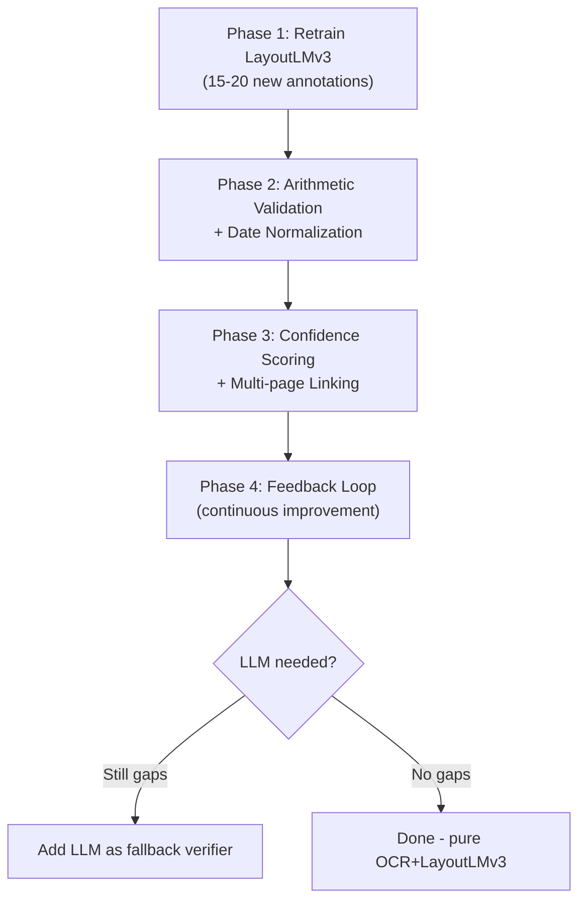

# OCR + LayoutLMv3 Pipeline

## Current State (After 2 Batch Tests)

| Metric | Status |
|---|---|
| Supplier/Buyer Name | ✅ 98-100%, clean |
| Invoice Date | ✅ 96% |
| PO Number | ✅ 87%, clean 7-digit |
| Item Description | ✅ 100% |
| Item Qty/Price | ✅ 95-97% |
| Total Amount | ⚠️ 53% |
| Invoice Number | ⚠️ 45% (clean values only) |
| SO Number / Terms | ⚠️ 54-62% |

---

## Should You Use an LLM?

### Short answer: **Not as a primary extractor. Yes as a post-processor — but only if needed.**

### Why NOT to use LLM as primary extractor:
1. **Speed**: Your current pipeline is **8.8s/invoice**. Adding an LLM call would add 3-15s per invoice (depending on model), nearly doubling processing time.
2. **Cost**: At scale (1000+ invoices/day), LLM API costs add up quickly. LayoutLMv3 runs locally for free.
3. **Reliability**: LLM outputs are non-deterministic — the same invoice can produce slightly different JSON each time. LayoutLMv3 is deterministic.
4. **Current accuracy is already strong**: 95%+ on items, 87-100% on key fields.

### When an LLM WOULD help (as post-processor):

| Task | LLM Benefit |
|---|---|
| **Validation/correction** | "This invoice says qty=1000 but total_price=50. Does that make sense?" |
| **Missing field inference** | If total_amount is missing but subtotal + discount exist, compute it |
| **Format normalization** | Convert dates like "Nov 6, 2025" to "11/06/2025" |
| **Edge cases** | Invoices from new vendors with completely different layouts |

### Recommendation:
> Use LLM as an **optional fallback** — only invoke it when LayoutLMv3 fails to extract critical fields (invoice_number, total_amount, or 0 items). This gives you 95% of benefits at 5% of the cost.

---

## Priority 1: LayoutLMv3 Retraining (Biggest Impact)

This is your **#1 investment** — every improvement here is permanent, free, and fast.

### What to Label

#### A. MELAND TOYS Layout (25 invoices affected)
These invoices have a completely different layout from VIRGINIA FOOD. The model has never seen this format.

**Action**: Take 5-8 of the `3857xxx.png` invoices and label them in Label Studio or your annotation tool:
- `INVOICE_NUMBER` — find where the invoice number appears on MELAND invoices
- `TOTAL_AMOUNT` — label the total (currently extracted as SUBTOTAL or missed entirely)
- `ITEM_DESCRIPTION` — label the second line of multi-line items as a continuation, OR label it as `OTHER` so the code doesn't create false items
- `PO_NUMBER` — verify the PO number position

#### B. Total Amount vs Subtotal Confusion (47 invoices affected)
The model confuses TOTAL_AMOUNT and SUBTOTAL on many VIRGINIA FOOD invoices.

**Action**: Review 10-15 invoices where total_amount was missing but subtotal was found. In the training data:
- Make sure `TOTAL_AMOUNT` is labeled on the **final grand total** (usually the last/largest amount, often labeled "TOTAL" or "AMOUNT DUE")
- Make sure `SUBTOTAL` is labeled on the **pre-discount/pre-tax amount**
- If there's only one total line, label it as `TOTAL_AMOUNT`, not `SUBTOTAL`

#### C. Invoice Number vs Barcode (17 invoices affected)
Barcodes near the header get mislabeled as INVOICE_NUMBER.

**Action**: In training data:
- Label barcodes and long reference numbers as `OTHER`
- Real invoice numbers typically start with "No." or "INV" — only label those as `INVOICE_NUMBER`

#### D. Quantity/Price Edge Cases (~16-22 items affected)
Some item quantities and prices are labeled `OTHER` instead of `QUANTITY`/`UNIT_PRICE`.

**Action**: Review the bottom rows of item tables in training invoices — the model tends to lose confidence at the bottom. Make sure every numeric in the item table is correctly labeled.

### Retraining Steps
```
1. Export current training data
2. Add 15-20 new annotations (5-8 MELAND, 10-15 VIRGINIA corrections)
3. Retrain LayoutLMv3 (same hyperparameters)
4. Re-run batch test and compare
5. Target: total_amount >85%, invoice_number >70%, item qty/price >99%
```

---

## Priority 2: Code Improvements (Medium Impact)

### A. Arithmetic Validation
After extracting items, cross-check:
```
sum(item.total_price) ≈ subtotal?
subtotal - discount ≈ total_amount?
qty × unit_price ≈ total_price per item?
```
Flag discrepancies for human review or auto-correct.

### B. Date Format Normalization
Currently dates come through as raw OCR text (`11/06/2025`). Add:
- Parse to `datetime` object
- Output in consistent ISO format or configurable format
- Handle `Nov 6, 2025`, `06-Nov-2025`, etc.

### C. Confidence Scoring Per Field
Add a confidence score per extracted field based on the LayoutLMv3 logit values. This lets you:
- Show low-confidence fields in yellow/red in the UI
- Trigger LLM verification only for low-confidence extractions
- Track model quality over time

### D. Multi-Page Invoice Linking
Currently each page is processed independently. For `_page_01.png` + `_page_02.png` pairs:
- Auto-detect page pairs by filename pattern
- Merge items from both pages
- Take header fields from page 1, financial totals from page 2

---

## Priority 3: Architecture (Long-term)

### A. Feedback Loop
Build a "correction" flow in the frontend:
1. User corrects a wrong field in the UI
2. Correction is saved alongside the original extraction
3. Periodically export corrections as new training data
4. Retrain LayoutLMv3 automatically → model keeps improving

### B. Template Matching
Since most invoices come from the same few vendors (VIRGINIA FOOD, MELAND TOYS, etc.):
- Auto-detect vendor from supplier name
- Apply vendor-specific post-processing rules
- E.g., VIRGINIA FOOD PO numbers always come with "SHIPPING INSTRUCTIONS" prefix

### C. LLM Integration (If Needed)
If you decide to add LLM, use it as a **verification layer**, not primary extraction:

```
Pipeline:
  PaddleOCR → LayoutLMv3 → Post-processing → [If confidence < threshold] → LLM verify
                                             → [If confidence >= threshold] → Done
```

This way ~90% of invoices skip the LLM entirely, saving time and cost.

---

## Recommended Execution Order



| Phase | Effort | Impact |
|---|---|---|
| **Phase 1**: Retrain LayoutLMv3 | 1-2 days labeling, 1 day training | 🔥🔥🔥 High — fixes 50+ invoices |
| **Phase 2**: Arithmetic + dates | 1 day coding | 🔥🔥 Medium — catches math errors |
| **Phase 3**: Confidence + multi-page | 2-3 days | 🔥🔥 Medium — better UX |
| **Phase 4**: Feedback loop | 3-5 days | 🔥🔥🔥 High — long-term auto-improvement |
| **LLM fallback** (optional) | 1-2 days | 🔥 Low — only if still needed after Phase 1-4 |

---

## Bottom Line

> **Don't add an LLM yet.** Your pipeline is already at 95%+ accuracy for items and key fields. 
> 
> Spend 1-2 days on **LayoutLMv3 retraining** (Priority 1) — this will likely push you to 97-99% accuracy. 
> 
> If gaps remain after retraining, add **arithmetic validation** (Priority 2) to catch remaining errors programmatically.
> 
> Only consider an LLM if, after retraining + validation, you still have >5% error rate on critical fields.
